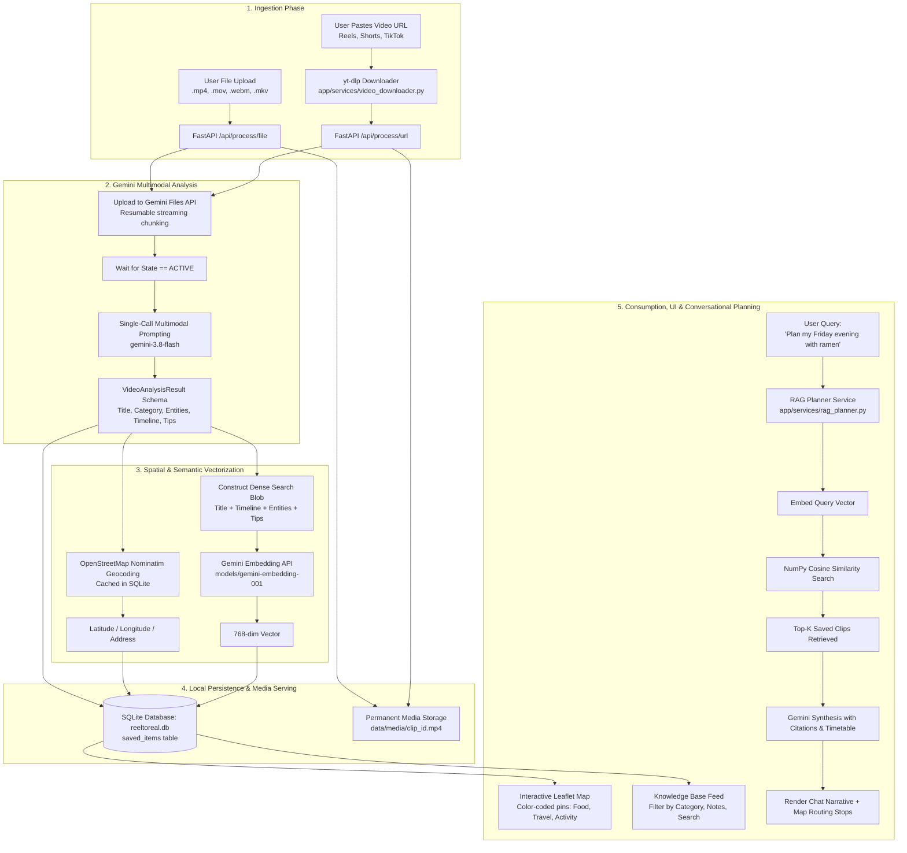

# 🎬 ReelToReal — AI-Powered Multimodal Personal Planner

[](https://fastapi.tiangolo.com/)
[](https://aistudio.google.com/)
[](https://ai.google.dev/)
[](https://leafletjs.com/)
[](https://sqlite.org/)
[](LICENSE)

> **Transform saved Instagram Reels, TikToks, and YouTube Shorts into an organized, searchable personal knowledge base with conversational AI planning and interactive map routing.**

---

## 🌟 Overview

Everyone saves endless short-form videos — a hidden ramen spot, a sunset ridge hike, or "5 cafes to try in the city" — only for them to sit forgotten in saved folders. Social platforms do not index spoken dialogue, visual scenery, or on-screen text, rendering saved clips completely unsearchable and non-actionable.

**ReelToReal** solves this by leveraging **Google Gemini Native Multimodal AI**. In a single unified reasoning call, Gemini extracts speech, visual landmarks, dishes, and text overlays. The system automatically categorizes the content, geocodes venues on an interactive Leaflet map, vectorizes the knowledge for semantic search, and provides a multi-turn conversational AI planner that synthesizes actionable itineraries directly grounded in your saved bookmarks.

---

## 🔄 End-to-End Workflow (From Scratch to End)

The diagram below illustrates the complete lifecycle of a saved video from raw ingestion to grounded conversational itinerary planning and map routing:



### Detailed Step-by-Step Breakdown

#### 1. Ingestion & Validation
- **Direct File Upload**: Videos (`.mp4`, `.mov`, `.webm`, `.mkv`, `.avi`) are streamed chunk-by-chunk via `aiofiles` into a temporary staging directory to maintain low memory overhead.
- **URL Scraper**: Uses `yt-dlp` integrated with `imageio-ffmpeg` to automatically download and merge high-resolution video and audio streams (`bestvideo[ext=mp4]+bestaudio[ext=m4a]`) from public links, with built-in socket timeouts and fallback messaging.

#### 2. Multimodal AI Understanding
- The local video file is uploaded to the **Gemini Files API** with robust MIME-type detection.
- Once processed (`ACTIVE`), a structured prompt is dispatched to `gemini-3.8-flash` (with automatic fallback to `gemini-2.5-flash` or `gemini-2.0-flash`).
- Gemini extracts:
  - **Exhaustive Sequential Timeline (`timeline_events`)**: Breakdown of every scene from `0:00` to the end, separating spoken dialogue (`audio_details`) from visual cues (`visual_details`).
  - **Structured Entities**: Primary place name, city, neighborhood, cuisine/activity type, price cues, best times to visit, highlights, and actionable tips (e.g., *"cash only"*, *"arrive before sunset"*).
  - **Categorization & Tags**: Food, Travel, Activity, Fitness, Shopping, Product, or Tip.
  - **Dense Search Blob**: A consolidated compilation of all extracted signals formatted specifically for vector retrieval.

#### 3. Spatial Enrichment (Geocoding Engine)
- The extracted venue and city are passed to the `GeocodingService`.
- Checks a local SQLite `geocode_cache` to eliminate redundant network roundtrips.
- If uncached, it queries **OpenStreetMap Nominatim** with a polite 1.1s rate-limiting buffer, retrieving precise latitude, longitude, and formatted addresses.
- Includes automated city-level fallback if a specific venue address is not indexed.

#### 4. Semantic Vectorization & Persistence
- The `EmbeddingService` sends the `search_blob` to `models/gemini-embedding-001` with `task_type="retrieval_document"`, generating a 768-dimensional embedding.
- All metadata, full JSON analysis, coordinates, and embeddings are stored in `data/reeltoreal.db` under the active user profile.
- Media is copied to `data/media/` and served over HTTP via `/media/` for instant in-browser playback.

#### 5. Conversational RAG Planner & Map Routing
- When a user submits a natural-language query (e.g., *"Plan my Friday evening with a ramen spot and dessert"*):
  1. Context from the previous 6 conversation turns is combined with the prompt.
  2. The query is vectorized via `task_type="retrieval_query"`.
  3. **NumPy Cosine Similarity** searches the stored vectors, retrieving the top-$K$ most relevant clips for that user.
  4. The retrieved clips, dishes, notes, and tips are injected into Gemini's context.
  5. Gemini outputs a step-by-step itinerary citing the exact source clips (`[Clip: Title / Place]`) and appends a structured ```` ```json_stops ```` block.
  6. The frontend extracts the stops, plots numbered route waypoints on the Leaflet map, and draws interactive itinerary markers.

---

## 🛠️ Tech Stack & Architectural Rationale

ReelToReal is designed around a **$0 Zero-Cost, Local-First Architecture** with no recurring SaaS bills:

| Layer | Selected Technology | Why This Specific Choice? | Traditional Alternative & Why Rejected |
|---|---|---|---|
| **Multimodal AI** | **Google Gemini (`gemini-3.8-flash`)** | Ingests **video frames + spoken audio + on-screen text overlays jointly** in a single API call with native temporal understanding. | **Whisper + OpenCV/FFmpeg + Tesseract OCR**: Requires 4 separate tools, high local GPU compute, high latency, and loses temporal correlation between speech and visual scenes. |
| **Embeddings** | **Gemini (`models/gemini-embedding-001`)** | Produces high-quality 768-dim dense semantic vectors with separate query/document asymmetric task types. | Heavy local PyTorch / SentenceTransformer models that significantly bloat container size and memory. |
| **Backend** | **FastAPI (Python 3.10+)** | Asynchronous I/O for streaming uploads and concurrent Gemini requests, native Pydantic validation, and auto-generated OpenAPI documentation (`/docs`). | Flask / Django: Synchronous I/O bottlenecks during file uploads; heavier footprint. |
| **Database & Vectors** | **SQLite + NumPy Cosine Similarity** | Embedded directly in the application; **$0 cost**, zero external database servers, completely self-contained, lightning-fast for personal knowledge base scales. | **Pinecone / Weaviate / Milvus**: Requires cloud accounts, monthly bills, network latency, and operational overhead. |
| **Geocoding** | **OpenStreetMap Nominatim** | Completely free, open-source geocoding with no API keys or credit card requirements. Coupled with local SQLite caching. | **Google Maps Geocoding API**: Imposes strict quotas and costly billing requirements. |
| **Interactive Map** | **Leaflet.js + OSM Tiles** | Lightweight (38KB), mobile-friendly, supports custom HTML/SVG markers, interactive popups, and route lines with zero API keys. | **Google Maps JS SDK / Mapbox**: Requires paid access tokens and recurring costs. |
| **Media Scraping** | **`yt-dlp` + `imageio-ffmpeg`** | Robust community-maintained media extraction with embedded ffmpeg binaries to ensure clean audio/video muxing. | Cloud scraping APIs: Adds unnecessary per-call subscription costs. |
| **Frontend** | **Vanilla JS + Glassmorphic CSS** | Ultra-responsive, zero compilation/npm build steps, fast browser load times, and custom CSS design system. | Heavy React/Next.js frameworks: Unnecessary complexity and build step overhead for this application scope. |

---

## 📁 Project Structure

```
ReelToReal/
├── app/
│   ├── config.py                 # App settings, paths, and environment validation
│   ├── main.py                   # FastAPI application, route definitions, static mounts
│   ├── models/
│   │   ├── __init__.py           # Models package export
│   │   └── schema.py             # Pydantic data contracts (Entities, SavedItem, RAG Plan, MapPins)
│   └── services/
│       ├── gemini_analyzer.py    # Native multimodal video engine via Gemini Files API
│       ├── embedding_service.py  # Gemini vector embeddings generator
│       ├── storage_service.py    # SQLite database, schema migrations & NumPy cosine search
│       ├── geocoding_service.py  # OpenStreetMap geocoder with caching & rate limiting
│       ├── rag_planner.py        # Conversational RAG itinerary planner & stop parser
│       └── video_downloader.py   # yt-dlp scraping with ffmpeg stream muxing
├── data/
│   ├── reeltoreal.db             # Local SQLite database (git-ignored)
│   └── media/                    # Permanent media storage for clip playback (git-ignored)
├── static/                       # Frontend Web Application
│   ├── index.html                # Single-page interface (Feed, AI Planner, Map View)
│   ├── css/
│   │   └── style.css             # Glassmorphic dark mode design system
│   └── js/
│       ├── app.js                # Knowledge base feed, search, filters, note editing, file upload
│       ├── chat.js               # Multi-turn conversational planner & citation handling
│       └── map.js                # Leaflet interactive map, custom category pins & itinerary routing
├── test_full_app.py              # End-to-end integration test suite
├── test_pipeline.py              # Standalone CLI test utility
├── verify_pipeline.py            # Component unit test suite
├── requirements.txt              # Production Python dependencies
├── .env.example                  # Environment configuration template
└── README.md
```

---

## ⚡ Key Features

- **⚡ Native Multimodal Video Understanding in 1 Call**:
  Speech, visual landmarks, dishes, decor, and on-screen text overlays are parsed jointly by `gemini-3.8-flash` without complex multi-model pipelines.
- **⏱️ Exhaustive Sequential Timeline**:
  Captures a full chronological breakdown of every scene from `0:00` to the end of the video, recording both spoken details and visual actions.
- **🗺️ Interactive Map View & Itinerary Routing**:
  Geocoded venues are plotted as color-coded pins (🍜 Food, ✈️ Travel, 🧗 Activity, 🛍️ Shopping). Itinerary stops generated by the AI planner are automatically connected into a visual map route.
- **🪄 Conversational Multi-Turn AI Planner**:
  Answers natural language planning queries by retrieving relevant bookmarks and generating step-by-step itineraries that cite the source clips. Supports follow-up prompts while retaining conversation context.
- **📝 Personal Notes & Annotation Editing**:
  Users can add custom notes (e.g., *"Visited on May 12, order the spicy miso"*), update tags, or refine venue names directly from the UI.
- **👥 User Profiles & Knowledge Base Metrics**:
  Switch between user profiles, view personal statistics (category distribution, top cities, mapped places), and export the entire knowledge base as downloadable JSON.
- **📁 Dual Ingestion Channels**:
  Drag-and-drop video upload (`.mp4`, `.mov`, `.webm`, `.mkv`) + public URL scraping via `yt-dlp` with graceful error handling.

---

## 🔌 API Reference

FastAPI provides interactive Swagger documentation at **`/docs`**. Key endpoints include:

| Method | Endpoint | Description |
|---|---|---|
| `POST` | `/api/process/file` | Upload and analyze a video file (`.mp4`, `.mov`, `.webm`, etc.) |
| `POST` | `/api/process/url` | Download and analyze a video from a public URL |
| `POST` | `/api/plan` | Generate a grounded itinerary via Conversational RAG |
| `GET` | `/api/items` | List all saved items for a user (filterable by category) |
| `GET` | `/api/items/{id}` | Retrieve details for a single saved item |
| `PUT` | `/api/items/{id}` | Update personal notes, tags, venue name, or city |
| `DELETE` | `/api/items/{id}` | Remove an item from the knowledge base |
| `GET` | `/api/map/pins` | Retrieve all geocoded pins for map visualization |
| `GET` | `/api/kb/stats` | Retrieve personal knowledge base metrics and breakdown |
| `GET` | `/api/kb/export` | Export the entire knowledge base as downloadable JSON |
| `GET` | `/api/users` | List all registered user profiles |
| `POST` | `/api/users` | Create or switch user profiles |
| `GET` | `/api/health` | Service health check and configuration status |

---

## 🏁 Quick Start

### 1. Prerequisites
- Python 3.10 or higher
- A free Gemini API key from [Google AI Studio](https://aistudio.google.com/)

### 2. Clone the Repository
```bash
git clone https://github.com/ERAMALINGAM-2007/ReelToReal.git
cd ReelToReal
```

### 3. Install Dependencies
```bash
pip install -r requirements.txt
```

### 4. Configure Environment Variables
Copy `.env.example` to `.env`:
```bash
cp .env.example .env
```
Edit `.env` and add your Gemini API key:
```env
GEMINI_API_KEY=AIzaSy...your_gemini_api_key...
GEMINI_MODEL=gemini-3.8-flash
GEMINI_EMBEDDING_MODEL=models/gemini-embedding-001
```

### 5. Launch the Application
```bash
python -m uvicorn app.main:app --host 127.0.0.1 --port 8000 --reload
```

Open your browser and navigate to:
- **Web Application**: [http://localhost:8000](http://localhost:8000)
- **Interactive API Docs**: [http://localhost:8000/docs](http://localhost:8000/docs)

---

## 🧪 Testing

Run the automated integration test suite:
```bash
python test_full_app.py
```

Run component unit tests:
```bash
python verify_pipeline.py
```

Process a single video file via the CLI test utility:
```bash
python test_pipeline.py --file path/to/your/clip.mp4
```

---

## 📄 License

This project is licensed under the MIT License — see the [LICENSE](LICENSE) file for details.
